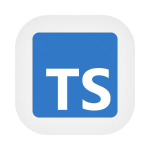

  

  
  
  
  

# Portal de validação do QA

O portal concentra atalhos e ferramentas para validar os serviços de QA. A equipe entra com uma conta, encontra o serviço no catálogo e abre sua documentação para executar chamadas. Uma tela separada permite iniciar o contato com serviços que podem estar hibernando no provedor de hospedagem.

A interface React usa uma biblioteca visual compartilhada e um servidor próprio para intermediar o Swagger de QA. Esse servidor valida o JWT e mantém credenciais de serviço fora do navegador. Os destinos permitidos são versionados. Links de produção continuam separados das chamadas intermediadas para QA.

## Aprofunde-se no Projeto!

- [OVERVIEW.md](./docs/OVERVIEW.md), finalidade e regras de produto.
- [ARCHITECTURE.md](./docs/ARCHITECTURE.md), componentes, dados e integrações.
- [RUNNING.md](./docs/RUNNING.md), preparação e execução local.
- [API.md](./docs/API.md), autenticação e uso do contrato.
- [SCREENS.md](./docs/SCREENS.md), detalhes do fluxo ou modelo de dados.
- [DEPLOY.md](./docs/DEPLOY.md), ambientes e publicação.
- [STATUS.md](./docs/STATUS.md), limites observados.
- [Fluxos](./flows/), etapas e casos de erro do repositório.
- [PENDENCIAS.md](./PENDENCIAS.md), questões para revisão.

## Contribuindo

- [CONTRIBUTING.md](https://github.com/Solierrr/.github/blob/main/.github/CONTRIBUTING.md), convenções de contribuição.
- [CODE_OF_CONDUCT.md](https://github.com/Solierrr/.github/blob/main/CODE_OF_CONDUCT.md), código de conduta.
- [SECURITY.md](https://github.com/Solierrr/.github/blob/main/SECURITY.md), relato de vulnerabilidades.
