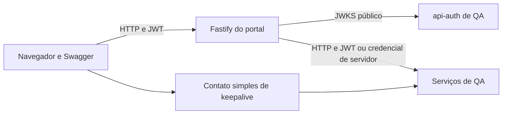

  

# Arquitetura

O frontend React é servido junto de um backend Fastify. O [catálogo permitido](https://github.com/Solierrr/web-sandbox/blob/main/shared/qa-services.json) limita os destinos do proxy.

A pasta `src/config/` mantém o catálogo e a configuração, a `src/features/` organiza o acesso, o catálogo, o keepalive e o Swagger, a `server/portal/` valida o JWT, os caminhos, as credenciais e os contratos e a `shared/` fornece os destinos fixos.

O backend valida assinatura RS256, emissor, expiração e tipo access. O navegador não escolhe URLs arbitrárias. O proxy bloqueia redirecionamentos, referências OpenAPI externas e caminhos internos. O JWT passa entre abas por comunicação com validação de origem e identificação da aba.

O portal não tem banco próprio, e as credenciais específicas são injetadas apenas no servidor, segundo o mapa de `upstreamHeaders`.