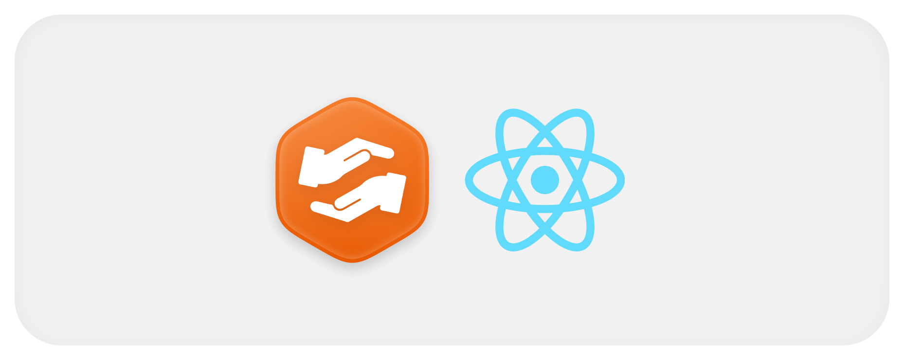

  

# Telas de validação

O catálogo organiza repositórios por linguagem, framework e tipo e mantém filtros na URL. Os atalhos abrem GitHub, aplicação ou documentação disponível.

A tela de keepalive oferece seleção individual e conjuntos de serviços. Ela faz contato simples pelo navegador e não chama o repositório de keepalive.

O Swagger usa uma página independente, com assets próprios. A aba original renova e fornece a sessão quando necessário.

O grupo Fluxo de IA reúne o Simulador, as Conversas, o Playground e os Dashboards. Eles chamam os serviços de QA direto do navegador, com o JWT do administrador, e estão descritos em [ADMIN.md](./ADMIN.md).
