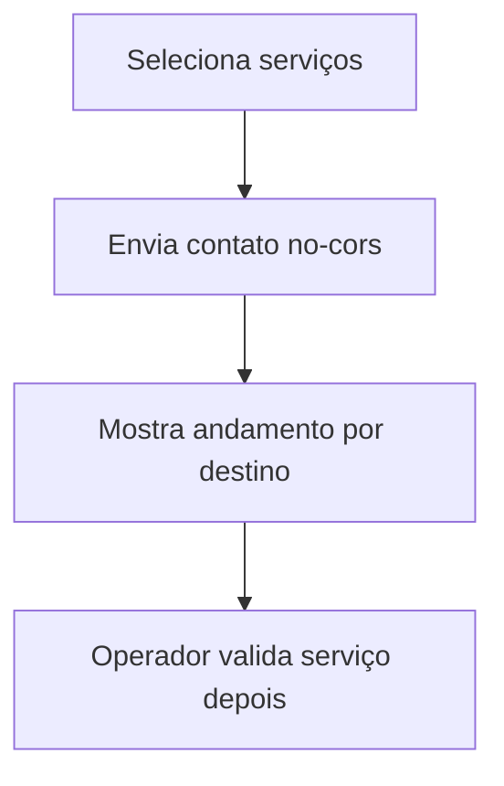

  

# Contato com serviços de QA

O operador seleciona um conjunto e inicia contatos para reduzir o tempo de despertar.

Uma resposta opaca do navegador não comprova que o serviço está pronto, e as falhas ficam restritas ao destino afetado. A rotina agendada está documentada separadamente, no repositório de keepalive.