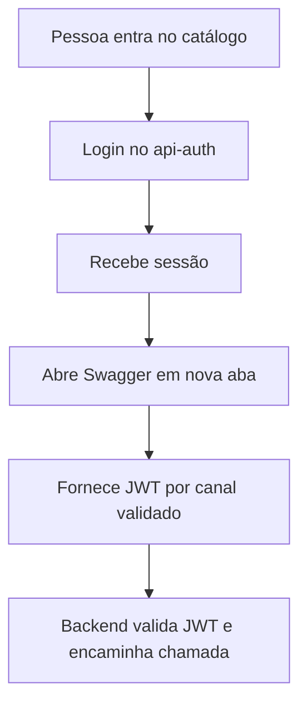

  

# Acesso ao portal

A sessão real de QA autoriza o uso do proxy.

Um token inválido impede o uso do proxy, e uma sessão de mock local não concede acesso aos serviços. O fluxo central está em [LOGIN_AND_TOKEN.md](https://github.com/Solierrr/docs-warehouse/blob/main/docs/flows/LOGIN_AND_TOKEN.md).