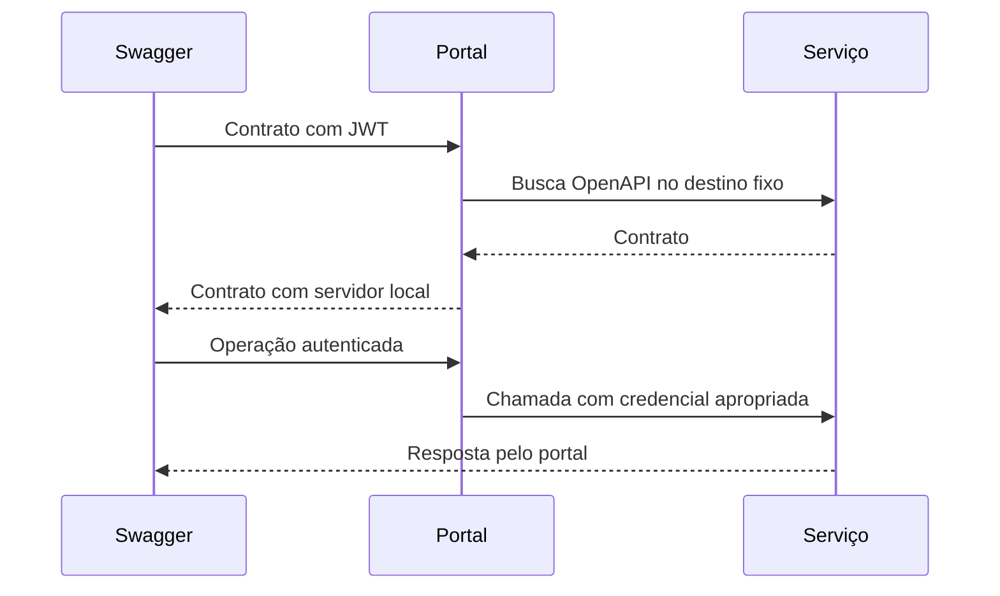

  

# Documentação de serviço

A pessoa seleciona um serviço permitido e usa seu contrato pelo proxy de QA.

Referência externa, destino arbitrário e rota interna são bloqueados. Uma resposta que reflita credenciais injetadas também é recusada.
